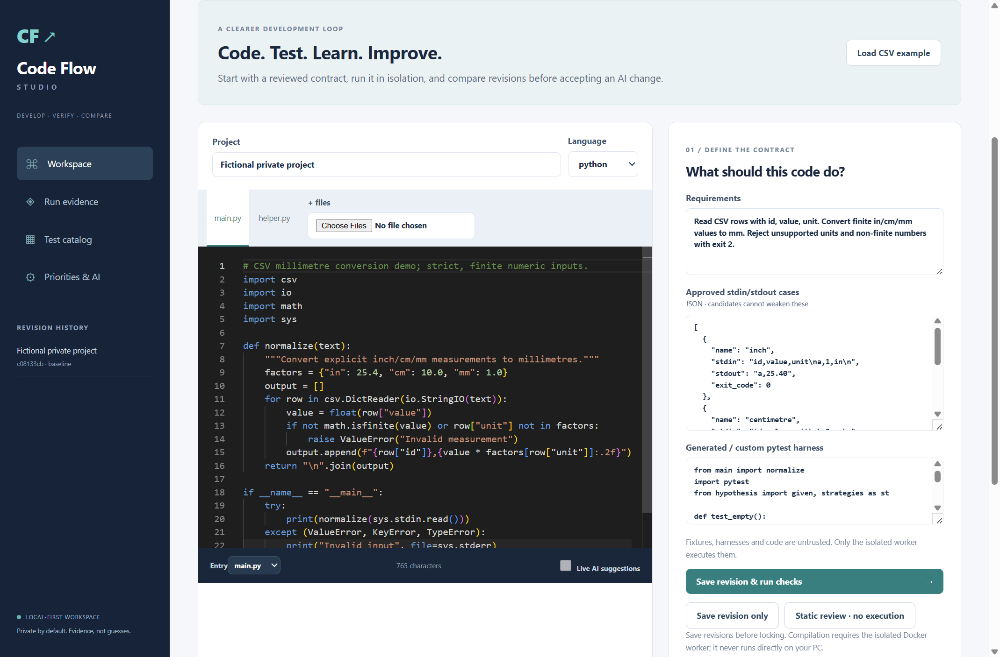
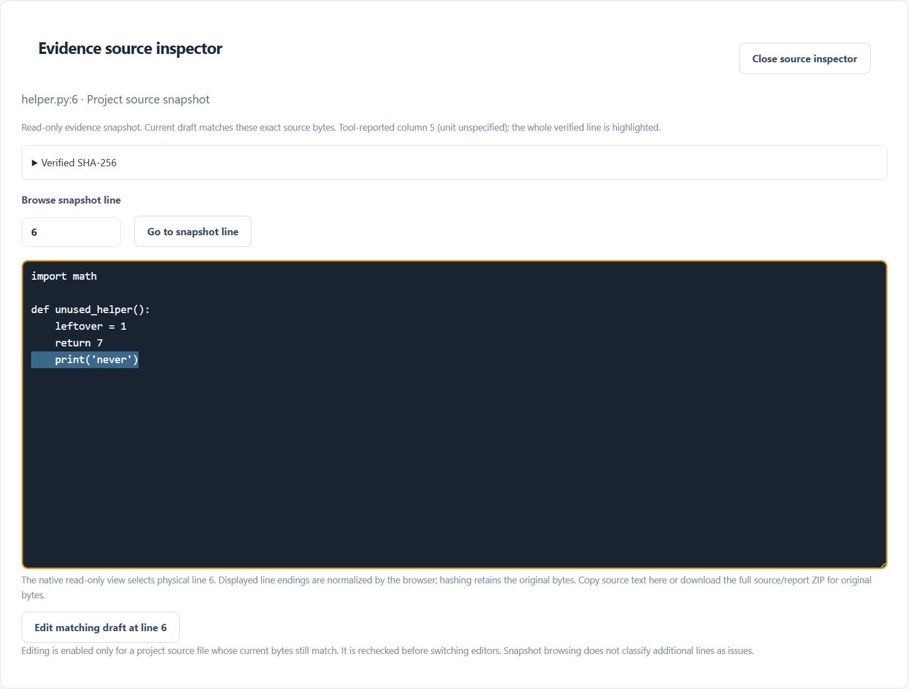

# Windows application acceptance — 10 November 2026

Author: Jason Stys. Runtime: published **0.4.3**, source
`1d0b19ed589947ae45e93555d97331c95cad26cc`.

The existing installed Windows executable passed a fresh native user journey.
The test used separate temporary launcher and account directories, real account
registration, browser WebCrypto unlock, synthetic source editing, revision
storage, static review, exact-line source inspection, category browsing and
locking. It observed actual HTTP drain, workspace sealing, service-thread exit,
and disappearance of the owned service and bootloader PIDs. The installed Node
analyzer and CSharp bridge matched their release-resource SHA256 identities.
No real account was opened, no provider was called, and Docker was unchanged.

## Reproduce and review

Use the matching release installer and checksum from
[0.4.3](https://github.com/JasonStys/code-flow-studio/releases/tag/v0.4.3).
With the declared development dependencies installed, set `STUDIO_INSTALLED_APP`
to the installed executable and run `npm run test:desktop`. The test creates its
own synthetic account and launcher profiles; do not substitute a real data root.
Without that variable it exercises the development Electron launcher instead.

The journey now captures three actual application views: the workspace, verified
source inspector and test catalog. The first two are embedded in the
[illustrated application guide](windows-application-guide.docx). Its
[publication evidence](windows-application-guide.json) binds the actual image
bytes and immutable source excerpts and records review of all four rendered
pages. The original reviewed Office editions remain historical evidence at their
own source and date.

## Evidence boundaries

- Fresh Windows source checks passed 417 tests with two platform-specific skips
  and 85.12 percent controller/training coverage at the unchanged 80 percent
  floor. Twelve Node tests, TypeScript, Ruff and 97 source maps also passed.
  The Word file passed OOXML schema validation and review of all rendered pages.
- This installed journey passed once using the actual compiled executable; no
  backend or account mock supplied the UI results.
- The 419 source tests, 28 subtests and 85.01 percent controller/training coverage
  belong to the separately published 0.4.3 validation. They are not coverage
  measurements of this one desktop journey.
- Hosted CSharp compiler/collector controls are documented in the
  [coverage report](csharp-coverage-2026-11-10.md). Local compilation was not run
  during this desktop check. A working isolated worker engine is required for it.
- Static unused-code candidates are review prompts, not proof of dead code.
  Source digests bind retained bytes; they do not attest a malicious target.
- The test did not replay real credentials, migrate a populated user vault,
  establish signed-installer reputation, or certify every Windows configuration.
- Existing account stores, the installed version and existing desktop shortcut
  were retained. No new runtime version was needed for documentation captures.

Current documentation-branch and main Actions checks are recorded separately
after they complete; the immutable runtime identity above remains unchanged.
